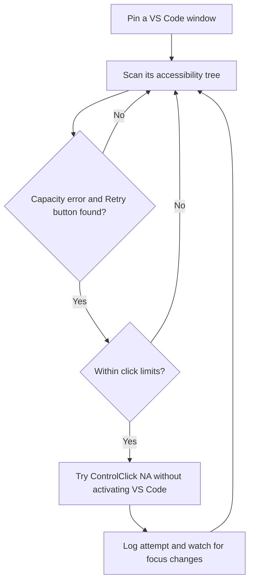

# Codex Auto Retry

**Automatically retry OpenAI Codex's `Selected model is at capacity` errors in Visual Studio Code on Windows.** This open-source AutoHotkey tool supports experimental background Retry clicks, configurable rate limits, and a pinned VS Code window.

**[Download ZIP (source)](https://github.com/luzay-max/codex-auto-retry/archive/refs/heads/main.zip)** · [Quick start](#quick-start) · [中文文档](README.zh-CN.md) · [Report a bug](https://github.com/luzay-max/codex-auto-retry/issues/new/choose)

> **Unofficial community project.** Not affiliated with or endorsed by OpenAI or Microsoft. This tool cannot increase server capacity, and a sent click is not proof of a successful retry.

## Features

- Pin a specific VS Code window (rather than clicking the foreground application).
- Find capacity errors and nearby enabled **Retry** controls using UI Automation.
- Attempt background clicks without intentionally activating VS Code or moving the mouse.
- Adjust the scan period, minimum click interval, rolling 60-second rate cap,
  and total attempts per run through a small GUI.
- Local configuration persists between restarts.
- Auto mode starts **disabled**; manual testing is encouraged.
- Attempted clicks are counted and logged; automatic mode stops at the session limit
  or if VS Code unexpectedly gains foreground focus.

**Limits:** Actual background behavior depends on the VS Code/Codex/Electron
version. Windows UI Automation may not expose the button; Chromium may ignore
a background click, or the application may still take focus. Minimized windows
are not supported. `SENT` means a click message was sent, **not** that Codex
actually retried.

## How it works

**Background clicking is experimental.** The button must be visible in the pinned, non-minimized VS Code window. If Chromium ignores the click, the tool does not claim success.

## Requirements

- Windows 10 or 11
- Visual Studio Code with the Codex extension
- [AutoHotkey v2](https://www.autohotkey.com/)
- Windows PowerShell 5.1 (`powershell.exe`; built into many Windows installations)

No administrator privileges should normally be needed.

## Quick start

You can [download the repository as a ZIP](https://github.com/luzay-max/codex-auto-retry/archive/refs/heads/main.zip), extract it, and follow these steps. A GitHub Release download will be linked here once an official release is published.

1. Download the source files (`CodexAutoRetry.ahk` and `UiaRetry.ps1`) into
   the **same writable directory**.
2. Optionally copy `settings.example.ini` to `settings.ini`. Without it,
   the script loads built-in defaults; saving settings creates `settings.ini`.
3. Close older running versions to prevent duplicate clicking.
4. Double-click `CodexAutoRetry.ahk` with AutoHotkey v2.
5. Focus the VS Code window you want to monitor and press `Ctrl + Alt + F10`.
6. Switch to another application. Press `Ctrl + Alt + F9` to test detection,
   then `Ctrl + Alt + F7` to make one experimental background click.
7. If the click works without disrupting your foreground app, press
   `Ctrl + Alt + F6` to enable automatic mode.
8. Open settings with `Ctrl + Alt + F5` (or via the tray icon).

The script runs UI Automation through a PowerShell subprocess using
`-ExecutionPolicy Bypass` for that invocation; it does not modify the
machine-wide execution policy.

## Shortcuts

| Shortcut | Action |
| --- | --- |
| `Ctrl + Alt + F5` | Open rate and interval settings |
| `Ctrl + Alt + F6` | Toggle automatic retry (off by default) |
| `Ctrl + Alt + F7` | Attempt one background click (counts toward limits) |
| `Ctrl + Alt + F8` | Pause/resume monitoring |
| `Ctrl + Alt + F9` | Detection test only, no click |
| `Ctrl + Alt + F10` | Pin the active VS Code window; reset counters and disable auto |
| `Ctrl + Alt + Q` | Exit |

## Settings

| Setting | Default | Valid range |
| --- | ---: | ---: |
| Maximum clicks per rolling 60 seconds | 2 | 1–60 |
| Minimum interval between click attempts | 15 seconds | 1–600 seconds |
| Maximum attempts per script run | 20 | 1–1000 |
| Scan period | 5 seconds | 1–60 seconds |

All three attempt limits apply **together**. The scan period controls how
frequently the script checks the interface, not how often it clicks.

Values are saved to `settings.ini` next to the script. `retry.log` stores
attempt times, coordinates and errors. Both files are excluded from Git.

## Troubleshooting

- **`NO_BUTTON`:** The UI Automation tree does not expose the Retry button.
  Ensure the target window is visible and the Codex error is displayed.
- **`NO_ERROR`:** A Retry button was seen, but no matching capacity error.
- **`NO_MATCH`:** The error and Retry button did not align as expected.
- **`SENT`, but nothing happens:** The background message may have been ignored
  by Electron/Chromium. Try the manual test before enabling auto mode.
- **Focus changes unexpectedly:** The app may bring itself forward. Automatic
  mode pauses/stops by design.
- **Two copies clicking:** Quit older tray scripts, then start only one.

## Safety and scope

Use reasonable retry limits. Repeated requests do not fix capacity limits and
can cause unnecessary traffic. The tool only targets an already visible,
enabled UI Automation button named `Retry`, adjacent to a matching capacity
message, in the pinned VS Code window. It does not bypass authentication,
service restrictions, or rate limits.

## Community

Bug reports, compatibility feedback, and pull requests are welcome. Please read [CONTRIBUTING.md](CONTRIBUTING.md) and use the [issue templates](https://github.com/luzay-max/codex-auto-retry/issues/new/choose). Never upload raw logs or screenshots containing private project details, tokens, or conversation content.

## License

[MIT](LICENSE). See [CHANGELOG.md](CHANGELOG.md) for release notes.